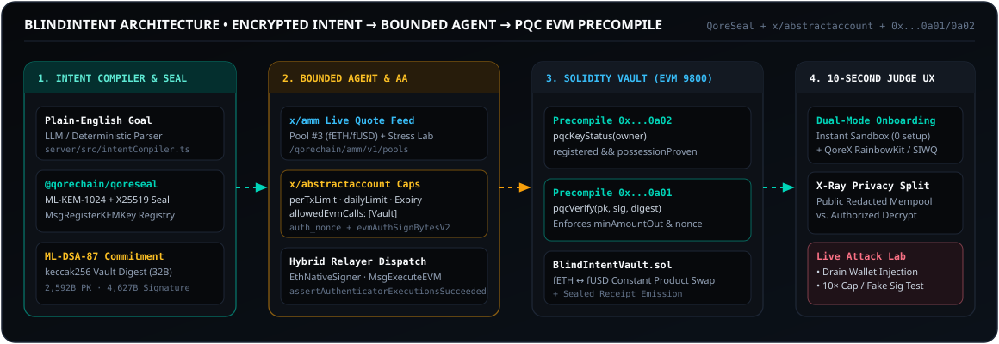
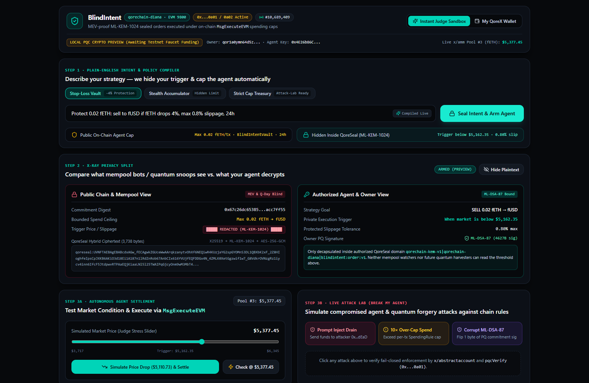
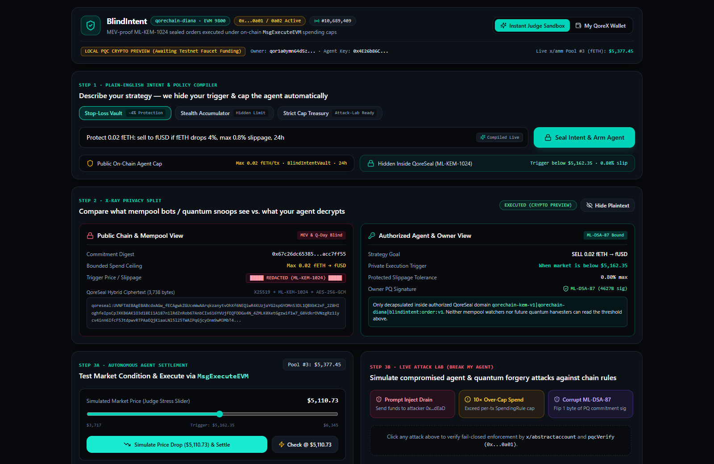
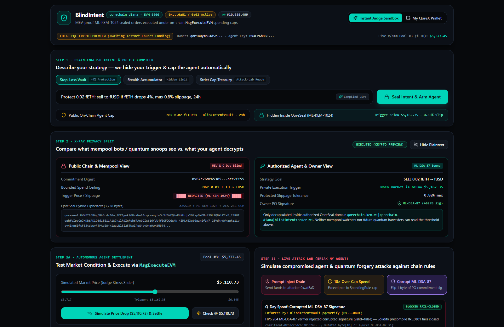

<div align="center">



# BlindIntent

**MEV-proof, post-quantum sealed trading intents executed autonomously by policy-capped AI agents on QoreChain.**

[](https://build.qorechain.io)
[](https://explore.qore.network)
[](https://docs.qorechain.io)
[](contracts/contracts/BlindIntentVault.sol)
[](LICENSE)

</div>

---

## One-Minute Judge Summary

Public on-chain limit orders, DCA triggers, and autonomous agent wallets share a structural flaw: **everyone in the mempool can read your exact trigger price and slippage floor**, letting searchers sandwich or hunt stops—and if the agent key leaks or gets prompt-injected, the user's treasury can be drained.

**BlindIntent** fixes both problems natively on **QoreChain**:

1. **Zero Strategy Leakage (`@qorechain/qoreseal` `ML-KEM-1024`):** Plain-English strategies are compiled into strict structured parameters, encrypted client-side into a domain-separated `QoreSeal` envelope (`blindintent:order:v1`), and posted on-chain alongside only an opaque `bytes32 commitmentHash`. Your trigger price and `minAmountOut` stay completely invisible to mempool observers and quantum adversaries.
2. **Bounded Agent Execution (`x/abstractaccount` `MsgExecuteEVM`):** The AI agent holds a scoped session authenticator (`secp256k1`) tied to the owner's `qor1...` account via an on-chain `SpendingRule` pinning `allowedEvmCalls` strictly to `BlindIntentVault`, with hard `perTxLimit`, rolling UTC `dailyLimit`, `allowedDenoms`, and `expiryUnix`. Even a fully compromised agent key cannot send a single wei elsewhere or exceed daily caps.
3. **Post-Quantum Settlement Proof (`0x...0a01` & `0x...0a02`):** Before `BlindIntentVault.executeSealedIntent` swaps reserves, Solidity queries QoreChain's native `pqcKeyStatus` (`0x...0a02`) precompile to verify `registered && possessionProven && algorithmId == 1 && keccak256(onChainPubkey) == keccak256(ownerPqPubkey)`, then verifies the owner's 4,627-byte `ML-DSA-87` signature over the EIP-style bound commitment digest via `pqcVerify` (`0x...0a01`).

> [!NOTE]
> **Live Testnet Deployment Status (`qorechain-diana`):** All smart contracts, PQC/KEM verification tests, Express relayer API, React UI, and automated launcher (`server/scripts/liveLaunch.ts`) are implemented and verified locally. Live testnet deployment & on-chain `Vault` + `x/amm` transactions execute via `npm --workspace=server run live:launch` once the generated `DEPLOYER` testnet address is funded with test QOR / fest tokens. Until `VAULT_ADDRESS` is populated, the Explorer cleanly indicates `LOCAL PQC CRYPTO PREVIEW` mode while running real `ML-KEM-1024`, `ML-DSA-87`, and live testnet RPC/Pool telemetry.

---

## Why BlindIntent?

| Dimension | Standard On-Chain Agent / Public Limit Order | **BlindIntent on QoreChain** |
| :--- | :--- | :--- |
| **Trigger Price & Slippage Privacy** | Plaintext calldata / public book entries exposed to MEV & stop-hunting | Encrypted inside `ML-KEM-1024` **`QoreSeal`** envelope; chain sees only `commitmentHash` |
| **Agent Blast Radius** | Agent holds an unrestricted EOA private key or broad ERC-20 `approve()` | Scoped **`x/abstractaccount` `SpendingRule`**: pinned `allowedEvmCalls`, `perTxLimit`, `dailyLimit`, `expiryUnix` |
| **Signature Quantum Resistance** | Vulnerable ECDSA recovery once Shor-scale quantum adversaries arrive | **`ML-DSA-87`** commitment verified in Solidity via **`0x...0a01` (`pqcVerify`)** & **`0x...0a02` (`pqcKeyStatus`)** |
| **Execution Receipt Privacy** | Execution prices & strategy outcomes remain permanently correlated in logs | Encrypted settlement receipt sealed exclusively for the owner via **`QoreSeal`** (`blindintent:receipt:v1`) |
| **Rogue Prompt / Tamper Defense** | Relies solely on off-chain LLM system prompts | **Fail-closed on-chain:** `SpendingRule` rejects rogue targets/overspend; EVM precompiles reject tampered PQC proofs |

---

## Cryptographic & On-Chain Pipeline

<div align="center">

</div>

### How The Protocol Enforces Safety In Solidity & Account Abstraction

**1. Post-Quantum Commitment Verification (`contracts/contracts/BlindIntentVault.sol`)**

Every execution must prove the owner holds a registered `ML-DSA-87` key with verified proof-of-possession on-chain (`0x...0a02`) AND signed the exact `commitmentHash` digest (`0x...0a01`):

```solidity
(bool registered, uint8 algorithmId, bytes memory onChainPubkey, bool possessionProven) =
    IQorePQC(_pqcKeyStatusAddress()).pqcKeyStatus(owner);

if (!registered) revert PqcKeyNotRegistered();
if (!possessionProven) revert PqcPossessionUnproven();
if (algorithmId != ML_DSA_87_ALGORITHM_ID) revert PqcWrongAlgorithm(algorithmId);
if (keccak256(onChainPubkey) != keccak256(ownerPqPubkey)) revert PqcPubkeyMismatch();

bool valid = IQorePQC(_pqcVerifyAddress()).pqcVerify(
    ownerPqPubkey,
    ownerPqSignature,
    abi.encodePacked(digest)
);
if (!valid) revert InvalidMlDsaSignature();
```

**2. Least-Privilege AI Agent Policy (`server/scripts/setupSandbox.ts` & `liveLaunch.ts`)**

The owner never hands over master keys. Instead, an ephemeral agent key is linked to the owner's QoreChain account via `linkAuthenticatorMsgs` with hard protocol-enforced limits:

```ts
spendingRules: [
  {
    id: "blindintent-vault-caps",
    enabled: true,
    perTxLimit: "1000000",     // 1 QOR native max per tx
    dailyLimit: "10000000",    // 10 QOR rolling UTC daily cap
    allowedDenoms: ["uqor", fUSD, fETH, fBTC],
    allowedEvmCalls: [vaultAddress], // Locked strictly to BlindIntentVault
    denomLimits: [
      { denom: fUSD, perTxLimit: "500000000", dailyLimit: "2000000000" },
      { denom: fETH, perTxLimit: "500000000000000000", dailyLimit: "1500000000000000000" },
    ],
  },
]
```

---

## Interactive Explorer Walkthrough

The frontend (`web/`) provides a zero-friction **Instant Judge Sandbox** alongside **My QoreX Wallet** (`@qorechain/qorex-rainbowkit` + `@qorechain/qoresign` SIWQ):

<table>
  <tr>
    <td width="50%" valign="top">
      <strong>1. Seal & Inspect Live X-Ray Privacy Split</strong><br/>
      Pick a preset or type plain English (e.g., <em>"Protect 0.02 fETH: sell to fUSD if fETH drops 4%, max 0.8% slippage, 24h"</em>). Left pane displays the redacted <strong>Public Chain &amp; Mempool View</strong> (<code>QoreSeal</code> ciphertext + opaque hash); right pane decrypts for the <strong>Authorized Agent &amp; Owner View</strong>.
      <br/><br/>
      
    </td>
    <td width="50%" valign="top">
      <strong>2. Market Trigger Slider &amp; Bounded Settlement</strong><br/>
      Simulate live price movement against QoreChain's live <code>x/amm</code> Pool #3 reference price. Once price crosses your sealed threshold, the relayer submits <code>MsgExecuteEVM</code> and seals an encrypted receipt back to the owner.
      <br/><br/>
      
    </td>
  </tr>
  <tr>
    <td colspan="2" valign="top">
      <strong>3. Live Attack Lab — Fail-Closed Proof</strong><br/>
      Test three adversarial scenarios in one click: <strong>Attack 1: Rogue Transfer Target</strong> (blocked by <code>allowedEvmCalls</code>), <strong>Attack 2: Daily Cap Exceeded</strong> (blocked by <code>perTxLimit</code> / <code>dailyLimit</code>), and <strong>Attack 3: Tampered ML-DSA-87 Signature</strong> (rejected by <code>0x...0a01</code> / <code>pqcVerify</code>).
      <br/><br/>
      
    </td>
  </tr>
</table>

---

## QoreChain SDKs & Stack

BlindIntent integrates **8 QoreChain ecosystem packages** alongside Hardhat 3, Express, React 18, and Tailwind v4:

| Layer | Packages / Modules | Purpose |
| :--- | :--- | :--- |
| **Core Chain & AA** | `@qorechain/sdk`, `@qorechain/evm` | `EthNativeSigner`, `linkAuthenticatorMsgs`, `executeEvmMsg`, `evmAuthSignBytesV2`, `openEvmWindowMsg`, `amm.swapExactIn`, `bank.send` |
| **Post-Quantum Crypto** | `@qorechain/pqc`, `@qorechain/qoreseal`, `@qorechain/qoresign` | `ML-KEM-1024` order/receipt envelopes (`seal`, `open`, `buildRegisterKemKeyMessage`), `ML-DSA-87` signing/verification, SIWQ auth |
| **Wallet & React** | `@qorechain/react`, `@qorechain/qorex-rainbowkit` | `QoreChainProvider`, QoreX RainbowKit wallet connector, live EVM window & KEM readiness checks |
| **AI Tooling** | `@qorechain/mcp` | QoreChain Model Context Protocol tools for chain telemetry & account inspection |
| **Smart Contracts** | Solidity `0.8.28`, Hardhat 3 + `viem` | `BlindIntentVault.sol` calling native precompiles `0x...0a01` & `0x...0a02` |
| **Agent Backend & UI** | Express `4`, TypeScript `5.6`, React `18`, Vite `5` | Intent compiler (`GEMINI_API_KEY`/`OPENAI_API_KEY` + deterministic fallback), relayer, Explorer UI |

---

## Quickstart & Reproducible Verification

### Prerequisites

- **Node.js `>= 20`** (`v24.20.0` verified) & **npm `>= 10`** (`11.19.0` verified)

### 1. Install, Build & Run All Offline Tests

```bash
git clone https://github.com/grzdev/blindintent.git
cd blindintent
npm install

# Compile Solidity contracts, typecheck Express agent/server, and build React Explorer
npm run build

# Run Hardhat contract unit tests + server PQC/KEM/intent-compiler tests
npm run test
```

Latest verified test output on this codebase:
- `npm --workspace=contracts run test`: **4 passing** (`BlindIntentVault` precompile bytecode check `610a01`/`610a02`, `possessionProven` & pubkey-mismatch rejection, signature tamper rejection + replay protection, E2E secret order settlement with slippage enforcement).
- `npm --workspace=server run test`: **4 passing** (`ML-KEM-1024` domain-separated seal/open & wrong-recipient rejection, `ML-DSA-87` 2,592B pubkey / 4,627B signature verification & tamper rejection, `evmAuthSignBytesV2` deterministic framing, natural-language intent compilation).
- `npm --workspace=web run build`: Zero TypeScript errors, clean Vite production bundle.

### 2. Configure Testnet Sandbox & Launch Locally

```bash
# Option A: Generate fresh TESTNET-ONLY mnemonics into gitignored .env
npm run sandbox:keygen

# Option B: Or copy .env.example to .env and populate keys
cp .env.example .env

# Run the Explorer (Express relayer on :8787 + Vite UI on :5173)
npm run dev
```

Open `http://127.0.0.1:5173` — the UI works immediately in **Instant Judge Sandbox** mode (`LOCAL PQC CRYPTO PREVIEW`) even before funding testnet keys.

### 3. Deploy & Execute Live on QoreChain Testnet (`qorechain-diana`)

Once your `DEPLOYER` address holds test `QOR` (and optionally fest `fUSD`/`fETH` from `https://dashboard.qorechain.io/faucet`), run the automated end-to-end launcher:

```bash
npm run live:launch
```

`server/scripts/liveLaunch.ts` automatically:
1. Splits test `QOR` from `DEPLOYER` to `SANDBOX_OWNER`, `SANDBOX_AGENT`, and `RELAYER` via `bank.send`.
2. Registers `ML-DSA-87` (`buildRegisterPqcKeyMsg`) and `ML-KEM-1024` (`buildRegisterKemKeyMessage`) keys on-chain.
3. Executes a live `x/amm` Pool `#2` swap (`uqor -> fUSD`) via `amm.swapExactIn`.
4. Opens an EVM window (`openEvmWindowMsg`), deploys `BlindIntentVault.sol` to Chain ID `9800`, verifies precompile bytecode, and writes `VAULT_ADDRESS` + `VITE_VAULT_ADDRESS` into `.env`.
5. Links `SANDBOX_AGENT` to `SANDBOX_OWNER` with `SpendingRule` locked strictly to `VAULT_ADDRESS`.
6. Approves & seeds ERC-20 vault reserves (when present) and executes a live `Seal -> Attack Lab -> Settle` smoke pass.

---

## Server API Reference (`server/src/index.ts`)

| Method & Path | Purpose |
| :--- | :--- |
| `GET /api/health` | Live `qorechain-diana` height, active precompiles, `x/amm` Pool `#3` reference price, sandbox readiness |
| `GET /api/orders` | List sealed/executed intents tracked by the agent session |
| `POST /api/intent/parse` | Compile natural-language prompt into structured order & `SpendingRule` limits |
| `POST /api/intent/seal` | Encrypt order with `ML-KEM-1024`, sign digest with `ML-DSA-87`, and register on-chain (if live) |
| `GET /api/orders/:id/decrypt` | Owner/Agent authorized `QoreSeal` open view for the X-Ray Privacy Split |
| `POST /api/agent/evaluate` | Evaluate simulated/live market price against sealed trigger; execute `MsgExecuteEVM` when met |
| `POST /api/attack/simulate` | Execute fail-closed adversarial checks (`unauthorized-target`, `over-spend-cap`, `pqc-signature-tamper`) |
| `GET /api/siwq/nonce` & `POST /api/siwq/verify` | Sign-In With QoreChain (`@qorechain/qoresign`) authentication |
| `ALL /lcd-testnet/*` | CORS-safe REST proxy to `https://api-testnet.qore.host` |

---

## Repository Structure

```text
blindintent/
├── contracts/
│   ├── contracts/
│   │   ├── IQorePQC.sol                  # Interfaces for native 0x...0a01 & 0x...0a02 precompiles
│   │   ├── BlindIntentVault.sol          # Intent commitment registry, PQC check, AMM vault swap
│   │   └── test/                         # MockQorePQC, MockERC20, TestableBlindIntentVault
│   ├── scripts/                          # EVM window manager & direct deploy script
│   └── test/BlindIntentVault.test.ts     # Hardhat 3 + viem contract test suite
├── server/
│   ├── src/
│   │   ├── config.ts                     # Network & fest ERC-20 / AMM config
│   │   ├── intentCompiler.ts             # LLM / deterministic natural-language policy compiler
│   │   ├── qoreClient.ts                 # Hybrid Stargate broadcaster & chain telemetry client
│   │   ├── blindIntentEngine.ts          # QoreSeal + ML-DSA-87 + MsgExecuteEVM + Attack Lab engine
│   │   └── index.ts                      # Express API + SIWQ + /lcd-testnet proxy
│   ├── scripts/
│   │   ├── setupSandbox.ts               # Testnet keygen + PQC/KEM/AA setup
│   │   └── liveLaunch.ts                 # Full automated testnet launch & live smoke verification
│   └── test/blindIntent.test.ts          # Real ML-KEM-1024 & ML-DSA-87 crypto test suite
├── web/                                  # React 18 + Tailwind v4 + RainbowKit Explorer UI
├── docs/                                 # SVG diagrams, 1280x720 cover asset, UI screenshots
├── AI_USAGE.md                           # Mandatory AI disclosure for AI-Native award
└── LICENSE                               # Apache License 2.0
```

---

## Honest Limitations & Engineering Disclosures

- **Local Unit Tests vs. Native Precompiles:** Hardhat's local `edr-simulated` EVM does not embed QoreChain's Go precompiles at `0x...0a01` and `0x...0a02`. Therefore, unit tests in `contracts/test/BlindIntentVault.test.ts` use `TestableBlindIntentVault` (a minimal test subclass overriding only `_pqcVerifyAddress()` and `_pqcKeyStatusAddress()` to point at `MockQorePQC`) alongside a direct bytecode test confirming unmodified production `BlindIntentVault.sol` embeds the exact native precompile addresses.
- **Preview Fallback Mode:** Without `VAULT_ADDRESS` populated and funded testnet accounts, the server runs real `ML-KEM-1024`, `ML-DSA-87`, and `evmAuthSignBytesV2` cryptography offline while displaying clear `LOCAL PQC CRYPTO PREVIEW` badges and live testnet block/AMM data.
- **Sandbox Order Persistence:** `BlindIntentEngine` stores active sandbox session records in memory rather than a persistent database to keep the hackathon server zero-config; production deployments should back sealed envelopes with PostgreSQL or SQLite.
- **Optional LLM Key:** `server/src/intentCompiler.ts` uses `GEMINI_API_KEY` or `OPENAI_API_KEY` if configured and falls back cleanly to deterministic parsing when absent.

---

## AI Usage & License

- **AI Disclosure:** See [AI_USAGE.md](AI_USAGE.md) for a complete breakdown of runtime AI components and AI-assisted development/verification workflows.
- **License:** Licensed under the **Apache License 2.0** — see [LICENSE](LICENSE).
